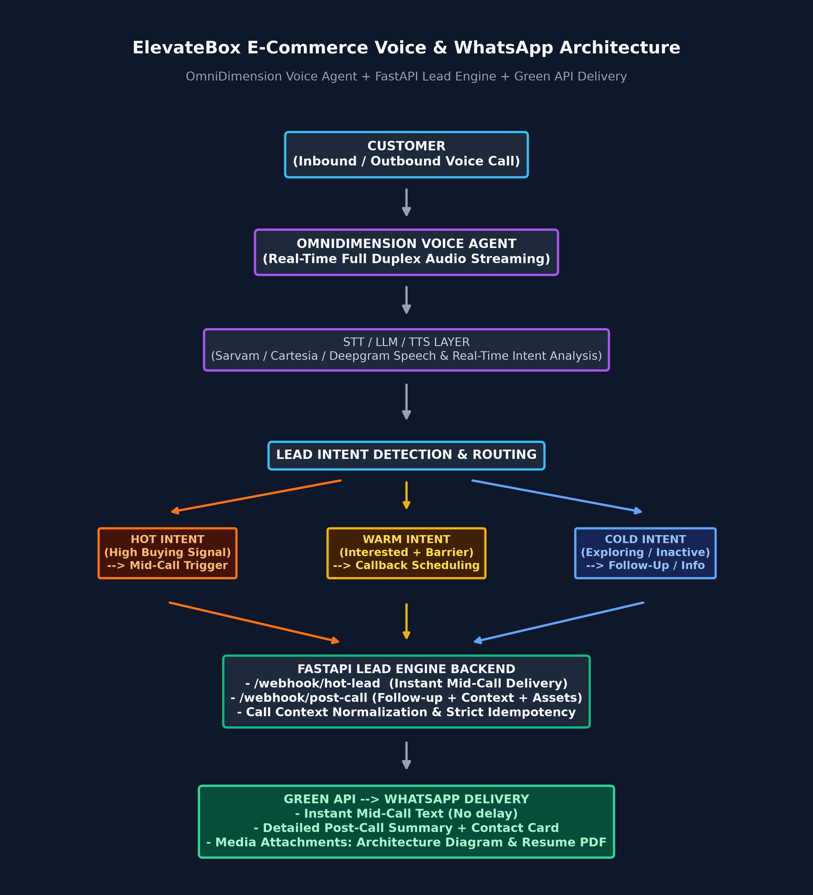

# Voice E-Commerce AI Agent & Omnichannel Lead Engine

[](https://www.python.org/)
[](https://fastapi.tiangolo.com/)
[](https://www.uvicorn.org/)
[](LICENSE)
[](#architecture)

An enterprise-grade, conversational voice agent and multi-channel lead qualification engine. The system integrates real-time bidirectional telephone interactions (via **OmniDimension**) with automated, contextual **WhatsApp** delivery (via **Green API** or **n8n**) to qualify e-commerce website prospects, classify buying intent (**HOT / WARM / COLD**), and deliver executive follow-ups without human intervention.

---

## Architecture Overview



```
                          +-------------------------+
                          |        CUSTOMER         |
                          | (Inbound/Outbound Call) |
                          +------------+------------+
                                       |
                                       v
                    +------------------------------------+
                    |     OmniDimension Voice Agent      |
                    |   - Sarvam / Deepgram STT (ASR)    |
                    |   - Cartesia / Sarvam TTS          |
                    |   - Multi-Turn Sales Prompt        |
                    +------------------+-----------------+
                                       |
                                       v
                    +------------------------------------+
                    |      Lead Temperature Engine       |
                    |      (HOT / WARM / COLD Eval)      |
                    +------------------+-----------------+
                                       |
           +---------------------------+---------------------------+
           | (Mid-Call HOT Trigger)                                | (Post-Call Completion)
           v                                                       v
+-----------------------+                               +-----------------------+
|  POST /webhook/hot-   |                               |  POST /webhook/post-  |
|         lead          |                               |         call          |
+-----------+-----------+                               +-----------+-----------+
            |                                                       |
            +---------------------------+---------------------------+
                                        |
                                        v
                    +------------------------------------+
                    |       FastAPI Lead Engine          |
                    |   - Context Normalizer             |
                    |   - Deduplication / Idempotency    |
                    |   - TRIAL_MODE Safety Router       |
                    +------------------+-----------------+
                                        |
                                        v
                    +------------------------------------+
                    |      Green API WhatsApp Engine     |
                    |     (or n8n Webhook Pipeline)      |
                    +------------------+-----------------+
                                        |
                                        v
                          +-------------------------+
                          |     WHATSAPP CLIENT     |
                          |  - Personalized Summary |
                          |  - Architecture Flow PNG|
                          |  - Solution PDF / Resume|
                          +-------------------------+
```

---

## Key Features & Technical Highlights

### 1. Real-Time Conversational Voice Agent (OmniDimension)
- **Sub-Second Latency:** Natural turn-taking and responsive acoustics (tested at ~1.19s–1.32s p50 conversational turn-response latency in benchmarked environments).
- **Multilingual Support:** Handles English, Hindi, and code-mixed vernacular phrases natively with Sarvam and Deepgram speech models.
- **Natural Turn Ownership:** Enforces strict one-response-per-turn rules to prevent conversational interruption during speech formulation or transcription delays.

### 2. Buying Intent Classification (HOT / WARM / COLD)
- **HOT:** Stated requirements + clear budget + timeline + immediate readiness or next-step questions. Triggers instant **mid-call** WhatsApp delivery.
- **WARM:** Qualified requirement present, but constrained by a barrier (e.g., partner approval, budget constraint, timing uncertainty). Routes to callback scheduling.
- **COLD:** Exploratory or non-committal inquiry. Provides helpful guidance without high-pressure sales tactics.

### 3. Deterministic Heuristic Context Normalization (Zero Hallucination)
- Normalizes freeform conversation transcripts or structured webhook payloads into standardized entities:
  - Business purpose (e.g., `"sell clothes online"`)
  - Inventory size (e.g., `"around 500–600"`)
  - Website budget (e.g., `"about ₹80,000"`)
  - Launch target (e.g., `"next month"`)
  - Required capabilities (e.g., payments, order tracking, inventory)
- **Zero-Hallucination Policy:** Fields omitted by the prospect during the call are cleanly omitted from follow-ups; the system never invents prices, timelines, or commitments.

### 4. Dual-Phase WhatsApp Dispatch
- **Mid-Call Trigger (`POST /webhook/hot-lead`):** Fires as soon as high intent is identified during the live voice conversation. Dispatches a concise introductory message so the prospect sees confirmation on their smartphone while still on the line.
- **Post-Call Summary & Collateral (`POST /webhook/post-call`):** Assembles a tailored conversational recap and automatically uploads multi-part collateral (architecture diagram PNG and candidate resume PDF).

### 5. Production Reliability & Idempotency
- **In-Flight Concurrency Guard:** Locks in-flight webhooks by `call_id` to block race conditions during rapid retries.
- **Processed Cache:** Caches completed dispatches and returns `200 OK` with `duplicate: true`, safely neutralizing duplicate webhook deliveries.
- **`TRIAL_MODE` Safety Interlock:** When `TRIAL_MODE=true`, all outgoing WhatsApp traffic is redirected to `TEST_WHATSAPP_NUMBER` to ensure real caller numbers are never messaged during development or evaluations.

---

## Technical Stack

| Layer | Technology | Purpose |
|---|---|---|
| **API Framework** | [FastAPI](https://fastapi.tiangolo.com/) `0.141.1` | High-performance asynchronous REST API backend |
| **ASGI Web Server** | [Uvicorn](https://www.uvicorn.org/) `0.52.4` | Lightning-fast ASGI production server |
| **Validation & Schemas** | [Pydantic](https://docs.pydantic.dev/) `2.13.4` | Type safety and request body validation |
| **HTTP Client** | [HTTPX](https://www.python-httpx.org/) `0.28.1` | Asynchronous HTTP client for telephony & WhatsApp APIs |
| **Voice Platform** | [OmniDimension](https://omnidim.io/) | Full-duplex real-time voice telephony agent |
| **Messaging Delivery** | [Green API](https://green-api.com/) | WhatsApp instance messaging and file upload API |
| **Workflow Automation** | [n8n](https://n8n.io/) | Optional visual webhook pipeline for CRM & notifications |
| **Diagram Generation** | [Matplotlib](https://matplotlib.org/) `3.11.1` | Automated architecture flowchart rendering |

---

## Repository Structure

```
.
├── assets/
│   ├── sample_resume.pdf            # Sample portfolio resume attached to post-call follow-ups
│   └── system_architecture.png      # Pre-rendered high-resolution architecture diagram
├── config/
│   ├── agent_config.json            # Sanitized OmniDimension agent configuration definition
│   └── agent_prompt.txt             # Full multi-turn sales qualification prompt instructions
├── docs/
│   └── ARCHITECTURE.md              # In-depth technical architecture and state specifications
├── scripts/
│   ├── generate_arch_diagram.py     # Script to render the architecture flowchart using Matplotlib
│   └── make_call.py                 # Outbound dispatch utility to initiate live voice test calls
├── tests/
│   ├── test_suite.py                # Comprehensive test suite (7 verification test scenarios)
│   └── test_whatsapp.py             # Diagnostic script verifying Green API WhatsApp authorization
├── workflows/
│   └── n8n-automation.json          # Sanitized n8n workflow template with env placeholders
├── .env.example                     # Environment template with required variables and documentation
├── .gitignore                       # Production-grade git exclusion rules
├── classifier.py                    # Standalone rule-based lead qualification classifier
├── LICENSE                          # MIT License
├── main.py                          # FastAPI application, route handlers, and middleware
├── requirements.txt                 # Pinned project dependencies
└── whatsapp_service.py              # Context normalizer, Green API client, and idempotency logic
```

---

## API Specification

| Method | Endpoint | Description | Request Body | Response Highlights |
|---|---|---|---|---|
| `GET` | `/health` | System health check & connectivity audit | None | `{"status": "ok", "whatsapp_authorized": true}` |
| `GET` | `/whatsapp/status` | Current Green API instance state | None | `{"statusInstance": "authorized", "authorized": true}` |
| `POST` | `/webhook/hot-lead` | Mid-call HOT lead trigger | [HotLeadWebhookRequest](#example-hot-lead-payload) | `{"ok": true, "status": "sent"}` |
| `POST` | `/webhook/post-call` | Post-call completion and collateral delivery | [PostCallWebhookRequest](#example-post-call-payload) | `{"success": true, "status": "sent", "attachments_count": 2}` |
| `POST` | `/test/whatsapp` | Developer WhatsApp test (strictly to `DEV_RECIPIENT_CHAT_ID`) | `{"message": "string"}` | `{"success": true, "messageId": "..."}` |

---

## Example Webhook Payloads & Output

### Example: Mid-Call HOT Lead Payload

**Request (`POST /webhook/hot-lead`):**
```json
{
  "event": "hot_lead",
  "call_id": "call-1788546-live",
  "lead_temperature": "HOT",
  "business_type": "clothing",
  "what_they_sell": "apparel",
  "product_count": "around 500",
  "budget": "about ₹80,000",
  "timeline": "next month",
  "features": [
    "online payments",
    "order tracking",
    "inventory management"
  ],
  "important_context": "Customer is ready to proceed immediately.",
  "phone": "+15551234567"
}
```

**Response:**
```json
{
  "ok": true,
  "status": "sent"
}
```

> **Note:** The response intentionally returns minimal status metadata to prevent leaking large text blocks back into the voice agent's conversational prompt.

---

### Example: Post-Call Webhook & Generated Output

**Request (`POST /webhook/post-call`):**
```json
{
  "event": "post_call",
  "call_id": "call-1788546-live",
  "business_goal": "sell clothes online",
  "product_count": "around 500–600",
  "budget": "about ₹80,000",
  "timeline": "next month",
  "features": [
    "payments",
    "order tracking",
    "inventory management"
  ],
  "phone": "+15551234567"
}
```

**Generated WhatsApp Text Delivered to Customer:**
```text
Hi, thanks for speaking with me.

You mentioned that you're looking to sell clothes online, with around 500–600 products, a budget of about ₹80,000, and a target launch of next month.

Your main requirements were payments, order tracking and inventory management.

Based on what we discussed, the e-commerce website can be tailored around these requirements. I'll follow up with the relevant details.

— Alex
📞 +1-555-123-4567
```

**Automated Attachments Sent Alongside Message:**
1. `ElevateBox_System_Architecture.png` (High-res system flowchart)
2. `Alex_Resume.pdf` (Professional candidate portfolio resume)

---

## Setup & Local Installation

### 1. Prerequisites
- Python 3.10+ (tested on Python 3.13)
- An active [Green API](https://green-api.com/) WhatsApp instance (Free Developer tier supported)
- An [OmniDimension](https://omnidim.io/) voice platform account (for live outbound/inbound telephony)

### 2. Clone and Setup Virtual Environment
```bash
# Clone the repository
git clone https://github.com/your-username/voice-ecommerce-ai-agent.git
cd voice-ecommerce-ai-agent

# Create and activate virtual environment
python -m venv venv

# Windows (PowerShell):
.\venv\Scripts\Activate.ps1
# Linux / macOS:
source venv/bin/activate

# Install dependencies
pip install -r requirements.txt
```

### 3. Configure Environment Variables
Copy the template file to `.env`:
```bash
cp .env.example .env
```
Edit `.env` with your actual instance credentials:
```ini
# Voice Telephony
OMNIDIM_API_KEY=your_omnidim_api_key
OMNIDIM_AGENT_ID=your_agent_id

# WhatsApp (Green API)
GREEN_API_HOST=https://api.green-api.com
GREEN_API_ID_INSTANCE=your_instance_id
GREEN_API_TOKEN=your_token

# Safety Controls
TRIAL_MODE=true
TEST_WHATSAPP_NUMBER=15551234567
DEV_RECIPIENT_CHAT_ID=15551234567@c.us
DEFAULT_CUSTOMER_PHONE=+15551234567

# Contact Signature
MY_CONTACT_NAME=Alex
MY_CONTACT_PHONE=+1-555-123-4567
```

### 4. Run the Application
Start the FastAPI server with auto-reload:
```bash
uvicorn main:app --host 0.0.0.0 --port 8000 --reload
```
Interactive Swagger documentation is available at: [http://localhost:8000/docs](http://localhost:8000/docs)

---

## Verification & Testing

The repository includes a dedicated test suite verifying context normalization, anti-hallucination logic, idempotency, and live delivery:

```bash
# Execute the complete verification test suite
python tests/test_suite.py
```

### Test Suite Coverage:
- **Test 1:** Full customer context normalization & verbatim preservation.
- **Test 2:** Minimal customer statement (`"I want an online store."`) verifying zero hallucination of missing budget/timelines.
- **Test 3:** Planned business distinction (verifies "planning to sell" is never transformed into an existing physical shop).
- **Test 4:** Vague customer responses handling without fabricating requirements.
- **Test 5:** Webhook idempotency and duplicate event suppression (`call_id` deduplication).
- **Test 6:** Mid-call HOT lead trigger, minimal response verification, and recipient safety redirection.
- **Test 7:** Post-call follow-up summary generation and media attachment dispatch.

---

## Integration Guides

### OmniDimension Voice Agent Configuration
1. Import `config/agent_config.json` into the OmniDimension agent workspace.
2. Ensure the prompt context points to `config/agent_prompt.txt`.
3. In the agent's tool/webhook integration section, configure:
   - **Mid-Call Webhook:** `POST https://your-server-domain.com/webhook/hot-lead`
   - **Post-Call Webhook:** `POST https://your-server-domain.com/webhook/post-call`

### Optional n8n Workflow Automation
To route WhatsApp notifications through n8n:
1. Open your n8n workspace and select **Import from File**.
2. Select `workflows/n8n-automation.json`.
3. Set your n8n environment variables: `GREEN_API_HOST`, `GREEN_API_ID_INSTANCE`, and `GREEN_API_TOKEN`.
4. Point `N8N_WHATSAPP_WEBHOOK_URL` in `.env` to your n8n webhook URL.

---

## Known Limitations & Production Considerations

- **In-Memory Cache vs Distributed Redis:** The current idempotency cache uses Python in-memory dictionaries (`PROCESSED_HOT_CALLS`, `IN_FLIGHT_HOT_CALLS`). In a horizontally-scaled multi-worker deployment (e.g., Kubernetes or multiple Uvicorn workers), a distributed store such as Redis or DynamoDB should replace the in-memory cache to maintain cluster-wide idempotency.
- **Green API WhatsApp Rate Limits:** WhatsApp enforces anti-spam rate limits on newly activated numbers. For high-volume outbound campaigns, maintain sufficient inter-message pacing or utilize the official WhatsApp Business Cloud API.
- **Network Latency:** Performance benchmarks reflect tests in optimized regional environments. ASR/TTS latency will vary based on customer telephony network conditions and carrier routing.
- **Third-Party API Specifications:** Upstream OpenAPI specifications for third-party platforms are subject to provider licensing terms; consult the upstream [OmniDimension Documentation](https://docs.omnidim.io/) for direct API references.

---

## License

This project is licensed under the MIT License - see the [LICENSE](LICENSE) file for details.
